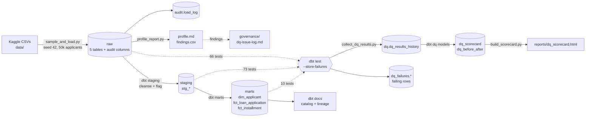
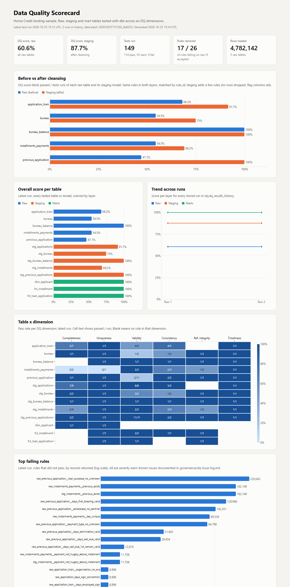
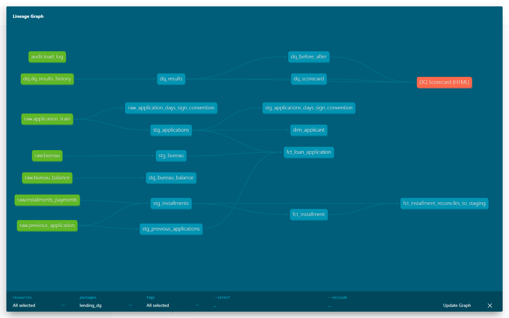
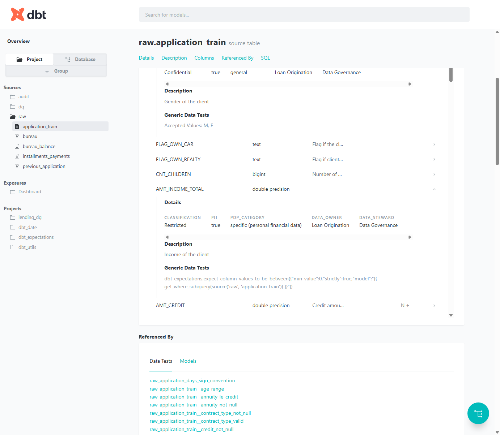
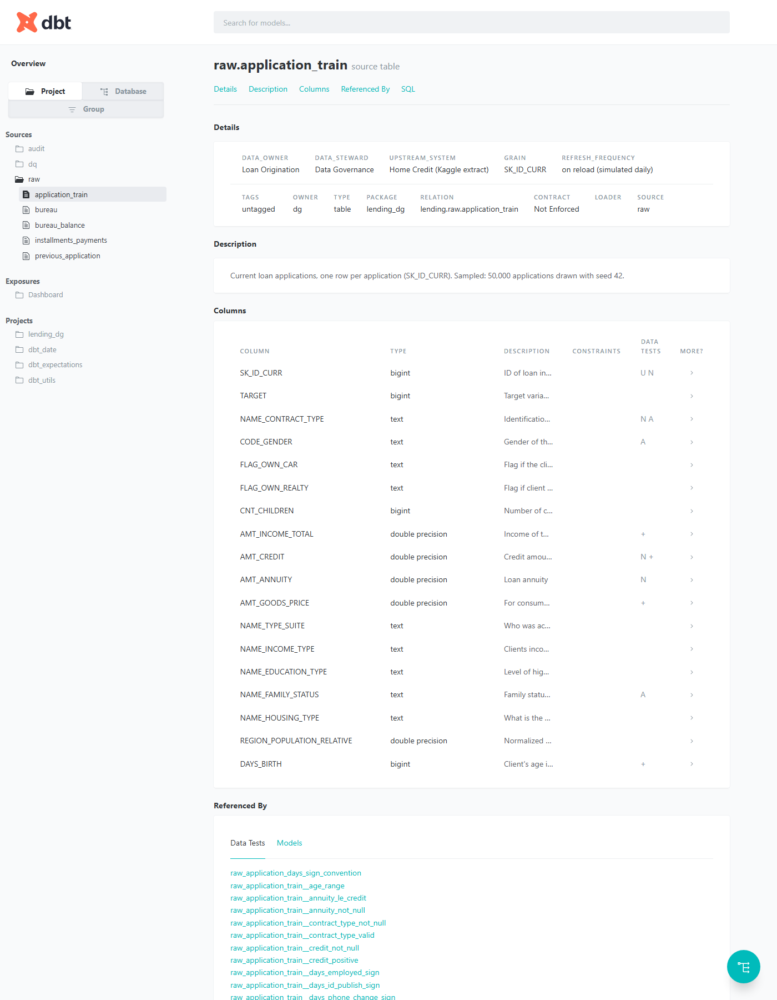

# Lending Data Quality & Governance Pipeline

A consumer lending company makes credit decisions on data it receives from applications, credit bureaus and its own repayment records, so it needs to know whether that data can be trusted and who is responsible for it. This project builds a small but complete data governance and data quality pipeline on the public **Home Credit Default Risk** dataset (5 tables, 50,000 sampled applications, 4.78 million rows). It profiles the raw data, turns every finding into a dbt test tagged with one of six DQ dimensions, cleanses the data without dropping a single row, stores test results over time, and publishes a DQ scorecard, a searchable data catalog with column classification and PII tags, a lineage graph, and the governance documents (classification, standards, RACI, issue log). Stack: Python 3.12, PostgreSQL 16 in Docker, dbt-core 1.11 with dbt_utils and dbt_expectations, pandas, SQLAlchemy, Plotly.js.

> Personal learning project on a public dataset. All numbers below come from the pipeline output of the latest run (2026-10-25).

## Architecture



## How to run

Prerequisites: Docker, Python 3.11+, Git Bash or any POSIX shell (Windows users without `make` can call `./run.sh <stage>` directly). Download the data first: create a Kaggle account, accept the [competition rules](https://www.kaggle.com/competitions/home-credit-default-risk/rules), then run `kaggle competitions download -c home-credit-default-risk` and unzip the CSVs into `data/`.

```bash
docker compose up -d   # Postgres 16 on localhost:5433
make setup             # venv, requirements, dbt deps
make all               # load, profile, build, test, scorecard, docs
make monitor           # second run: reload, rebuild, retest, append to history
cd dbt_project && dbt docs serve --port 8081   # catalog and lineage
```

Single stages: `make load | profile | build | test | scorecard | docs`. `make sources` regenerates `models/sources.yml` from the live schema and the Kaggle data dictionary.

## Key results (latest run)

| Metric | Value |
|---|---|
| Rows profiled | 4,782,142 across 5 tables and 187 columns |
| Profiling findings | 28 checks flagged (placeholders, unknown codes, sentinels, negative amounts, duplicate keys, orphans) plus 47 columns with 50%+ nulls |
| Issues logged | 19 in [dq-issue-log.md](governance/dq-issue-log.md), each with treatment |
| dbt tests | 149: 66 on raw, 73 on staging, 10 on marts; 104 `error`, 45 `warn` |
| Tests per dimension | validity 57, completeness 30, consistency 27, uniqueness 13, referential integrity 12, timeliness 10 |
| **DQ score before cleansing (raw)** | **60.6%** of tests pass (40 of 66) |
| **DQ score after cleansing (staging)** | **87.7%** of tests pass (64 of 73) |
| Rules tested in both layers | 66; 17 resolved by cleansing, 9 still open and accepted, 40 clean in both |
| Records returned by non-passing tests | 909,605 on raw, 176,307 on staging |
| Rows dropped by cleansing | 0 (enforced by `*_no_rows_dropped` tests) |
| Catalog coverage | 202 source columns (187 data + 15 audit) with description, classification, PII flag, UU PDP category, owner and steward; 53 Restricted, 64 Confidential, 85 Internal |
| Monitoring | 2 runs in `dq.dq_results_history`, 2 load batches in `audit.load_log` |

Per table, raw to staging: application_train 68.2% to 91.7%, bureau 54.5% to 75.0%, installments_payments 54.5% to 69.2%, previous_application 47.1% to 100%, bureau_balance 100% to 100%. All 10 mart tests pass.

The 9 open rules are known issues kept on purpose (flag, not delete): orphan installments (DQ-009, 162,149 rows), negative bureau debt (DQ-010), unpaid installments (DQ-013), overpayments (DQ-014), occupation nulls (DQ-016) and others, each with an owner decision in the issue log.

One rule turned out to be wrong, not the data: `DAYS_LAST_DUE_1ST_VERSION <= 0` failed on 31,423 legitimate future dates after placeholder removal. It was replaced with a plausibility window (DQ-018).

## Screenshots

**DQ scorecard** (`reports/dq_scorecard.html`): before vs after cleansing, score per table, trend across runs, table x dimension heatmap, top failing rules.



**Lineage graph** (dbt docs): raw sources to staging, marts, DQ models and the scorecard exposure.



**Catalog with column meta** (dbt docs): classification, PII, UU PDP category, owner and steward per column.





## Governance artifacts

- [Data classification](governance/data-classification.md): 4 levels, handling rules, rules used to classify 187 columns, UU PDP mapping
- [DQ standards](governance/dq-standards.md): 6 dimensions, thresholds, severity, what happens when a rule fails
- [Roles and RACI](governance/roles-raci.md): data owner, steward, custodian, consumer
- [DQ issue log](governance/dq-issue-log.md): 19 issues from discovery to treatment
- [Regulatory reference](governance/regulatory-reference.md): self-study mapping to POJK 4/POJK.05/2021, UU PDP and DAMA-DMBOK
- [Profiling report](profiling/output/profile.md)

## Repository layout

```
ingestion/sample_and_load.py      sample 50k applicants, load raw, audit columns, audit.load_log
profiling/profile.sql             profiling query templates
profiling/profile_report.py       writes profiling/output/profile.md, findings.csv, per-table CSVs
dbt_project/models/sources.yml    generated: descriptions, classification meta, raw tests, freshness
dbt_project/models/staging/       stg_* cleansing models and tests
dbt_project/models/marts/         dim_applicant, fct_loan_application, fct_installment
dbt_project/models/dq/            dq_results, dq_scorecard, dq_before_after, exposure
dbt_project/tests/                singular tests and the null_pct_below generic test
dbt_project/macros/               cleansing macros (clean_category, clean_days, ...)
dbt_project/scripts/              generate_sources.py
reports/                          collect_dq_results.py, build_scorecard.py, dq_scorecard.html
governance/                       governance documents
```

## Limitations

- **Sampled data**: 50,000 of 307,511 applications (seed 42). Counts in this README are for the sample, not the full dataset.
- **Static dataset**: the source never changes, so freshness and the trend across runs are simulated by reloading the same files. Both runs return the same test results; the history shows the monitoring mechanism, not a real improvement over time.
- **Thresholds and classification chosen by me**: null thresholds, the 2x overpayment rule, the 100-year plausibility window and every classification decision are my own judgement, not a company or regulator standard.
- **DQ score is test-based**: `dq_score_pct` counts passing tests, so a table with few tests can score 100% easily. `row_conformance_pct` in `dq_results` gives a row-weighted view. For `unique` and `accepted_values`, dbt counts duplicate keys or distinct bad values, not rows.
- **No enforcement**: classification and PII tags are metadata only; no masking, access control or alerting is implemented.
- **Regulatory notes** are a self-study mapping, not legal advice or a compliance assessment.
